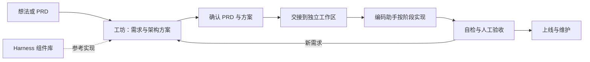

<div align="center">

# Leo Agent Kit

**把 AI 产品想法变成可执行的方案，再推进到有证据的交付。**

Harness 组件库 · 产品架构工坊 · 分阶段开发与验收


[快速开始](#快速开始) · [功能说明](#三个模块) · [完整文档](docs/README.md) · [广告视频产品示例](examples/marketing-video/README.md) · [命令参考](docs/cli.md)

</div>

## 这个项目解决什么问题

一个 AI 产品从想法到上线，通常要先回答三件事：需要哪些 Agent 能力、这些能力如何组成产品、开发到什么程度才能验收。

Leo Agent Kit 把这三段工作放在同一个仓库中。你可以查看组件实现，通过本地网页或命令行推导产品方案，再把确认过的 PRD 与方案交给编码助手，在独立工作区中按阶段实现。

| 你现在有什么 | 使用哪个模块 | 可以拿到什么 |
|---|---|---|
| 一个想法，技术方案还不确定 | 架构工坊 | 需求工作区、组件选型、架构方案、工具清单、待确认问题 |
| 一个已经有代码的 Agent 项目 | 工坊的项目检查 | 差距报告、代码证据，以及推断的需求文档或对照已有 PRD 的检查结果 |
| 需要权限、记忆、MCP、工作流等能力 | Harness 组件库 | s01–s17 的实现代码、机制图示和运行入口 |
| 已确认的 PRD 与方案 | 项目交付 | 独立工作区、阶段任务、自检结果、验收证据与进度记录 |
| 已有产品的新需求 | 工坊迭代与项目交付 | PRD 历史快照、选型变化、增量开发任务与下一轮验收 |

## 三个模块

### Harness · Agent 运行机制

覆盖模型调用循环、工具执行、权限控制、上下文管理、持久任务和多 Agent 协作。各目录都有代码和说明，可按需要单独查看。

| 能力组 | 包含内容 | 典型用途 |
|---|---|---|
| 基础执行 | s01 循环、s02 工具、s03 权限、s04 钩子 | 让模型调用工具，在执行前后加入约束 |
| 任务与上下文 | s05 待办、s06 子 Agent、s07 技能、s08 压缩、s09 记忆 | 拆分任务、按需加载能力、处理长对话与长期信息 |
| 长期运行 | s10 任务系统、s11 后台任务、s12 定时调度 | 保存依赖、处理慢操作和定时触发 |
| 协作与扩展 | s13 Agent 团队、s14 MCP | 多角色协作、接入外部工具 |
| 集成与控制 | s15 集成 Harness、s16 工作流、s17 目标循环 | 组合机制、记录执行、判断任务是否完成 |

s15 是集成实现，s16 在它上面扩展工作流；各独立示例并不都包含前面所有能力。选择具体实现时应检查其依赖和边界。

**[组件索引与运行方法 →](docs/harness.md)** · [浏览完整源码](vendor/claude-code-harness-study/)

### Workshop · 产品架构工坊

支持本地网页和命令行两种入口，围绕同一个产品工作区完成方案推导与迭代。

- **需求整理**：从一句话想法或 PRD 文件开始，记录目标用户、核心流程和待确认项。
- **方案推导**：拆解需求，按规则选择组件，生成架构、工具清单、系统提示词草案与测试设计。
- **产品迭代**：新需求先进入 PRD，保留历史快照，重新推导方案并记录组件选型变化。
- **项目检查**：检查已有项目，或用 PRD 对照 `skeleton/` 中的代码，输出差距与证据。
- **交接包**：将需求、方案、参考组件和给编码助手的说明打包为 ZIP。
- **网页操作**：新建产品、回答问题、查看方案、模拟试玩、版本历史、项目检查与导出。

网页试玩用于验证交互思路，工具结果采用模拟方式；真正的产品代码由编码助手实现并单独运行、验收。

**[工坊配置、命令与产物 →](docs/workshop.md)** · [引擎源码](vendor/agent-workshop/blueprint/) · [网页源码](vendor/agent-workshop/web/)

### Delivery · 分阶段项目交付

每个产品创建独立工作目录，保存规则、技术手册、PRD、开发产物和验收记录。进度写入文件，后续可以换会话、换编码助手继续工作。

| 阶段 | 主要工作 | 交付与确认 |
|---|---|---|
| 0 · PRD 体检 | 补齐用户、流程、范围与约束 | 需求补全清单和已确认决策 |
| 1 · 技术适配 | 确定技术实现与子阶段范围 | 技术适配声明、开发顺序 |
| 2 · 后端 MVP | 打通核心链路、处理模型调用与数据 | 后端代码、测试、真实模型验证证据 |
| 3 · 正式前端 | 实现交互、页面与移动端适配 | 可运行界面、构建与验收证据 |
| 4 · 上线 | 配置运行环境并验证部署 | 上线说明、访问与数据隔离检查 |
| 5 · 收尾 | 整理启动、维护和运行说明 | 项目 README 与最终状态记录 |

`kit.sh` 负责阶段任务与流转，`verify.sh` 检查文件、测试、模型验证记录、构建等项目。脚本通过后仍需用户实际验收；初始化工作区本身不会自动生成完整应用。

**[交付流程与证据目录 →](docs/delivery.md)** · [流程脚本](vendor/idea-to-launch-kit/kit.sh) · [技术手册](vendor/idea-to-launch-kit/docs/手册/)

## 工作流



工坊与交付工作区通过文档连接。工坊负责产品推导与方案演进；交付工作区负责正式实现与验收。两处文件不会自动双向同步。

## 快速开始

### 1. 获取项目并检查文件

准备 Python 3.10+、Git 和 Bash。完整交付流程以 macOS 为主要环境，开发具体应用时还需按手册准备 Node.js 等依赖。

```bash
git clone https://github.com/leo-ai-pm/leo-agent-kit.git
cd leo-agent-kit
python3 leo.py doctor
```

`doctor` 检查关键模块文件与 Bash 是否存在，不会验证模型连接或安装全部开发依赖。

### 2. 打开架构工坊

在仓库根目录执行：

```bash
python3 -m venv .venv
source .venv/bin/activate
python -m pip install -r vendor/agent-workshop/requirements.txt
python leo.py workshop -- ui --mock
```

终端会显示本地地址并尝试打开浏览器，默认端口为 `8765`。`--mock` 不调用模型，用占位结果演示流程，不代表真实推导质量。

要推导自己的方案，在 `vendor/agent-workshop/.env` 配置模型后去掉 `--mock`。具体字段和路径见[模型配置](docs/workshop.md#模型配置)。

### 3. 跑通方案到交付

以下命令在仓库根目录、已激活的虚拟环境中执行。示例只演示工作流，不会生成广告视频成片。

```bash
# 生成需求工作区与离线示例方案
python leo.py workshop -- init ad-video "为电商运营生成广告视频脚本与分镜，生成素材前确认预算，发布前人工确认" --plan --mock

# 创建独立交付工作区
python leo.py init ad-video

# 将两份文档一起交接，并记录文件摘要
python leo.py handoff ad-video vendor/agent-workshop/out/ad-video

# 生成当前阶段任务并查看进度
python leo.py delivery ad-video task
python leo.py delivery ad-video status
```

用编码助手打开 `workspace/ad-video/`，让它读取该目录中的 `AGENTS.md` 与当前阶段任务，开始具体实现。已有同名工作区不会被覆盖；再次体验时换一个产品名。

**[广告视频产品完整示例 →](examples/marketing-video/README.md)**

### 4. 查看 Harness 组件

```bash
# 启动组件浏览界面；纯浏览不需要模型 Key
python3 leo.py learn web

# 运行某个组件示例；可能安装依赖并调用模型
python3 leo.py learn s03
```

## 目录导航

完整的三个模块位于 `vendor/`，根目录提供统一 CLI、使用文档与业务示例。

```text
leo-agent-kit/
├── README.md                    # 产品总览与使用入口
├── leo.py                       # 统一命令入口
├── docs/                        # 工具箱使用文档
│   ├── README.md                # 按任务选择文档
│   ├── harness.md               # 组件索引与运行方式
│   ├── workshop.md              # 网页、模型、推导与检查
│   ├── delivery.md              # 阶段、工作区与验收
│   └── cli.md                   # 参数、路径和常见问题
├── examples/marketing-video/    # 广告视频产品需求与操作示例
├── tests/                       # 工具箱交接与保护行为测试
├── vendor/
│   ├── claude-code-harness-study/
│   │   ├── s01_agent_loop/ … s17_goal_loop/
│   │   ├── guide/               # 机制与选型参考
│   │   ├── web/                 # 浏览界面与运行支持
│   │   ├── skills/              # 技能示例
│   │   └── tests/
│   ├── agent-workshop/
│   │   ├── blueprint/           # 推导、检查、迭代与网页服务
│   │   ├── web/                 # 前端工程
│   │   ├── desktop/             # 桌面工程文件
│   │   ├── scaffold/            # 代码骨架参考
│   │   ├── s01_agent_loop/ … s17_goal_loop/
│   │   ├── docs/                # 示例输出、图示与实现说明
│   │   ├── evals/               # 评估案例
│   │   └── tests/
│   └── idea-to-launch-kit/
│       ├── AGENTS.md            # 开发与验收规则
│       ├── kit.sh               # 阶段管理
│       ├── verify.sh            # 自检
│       ├── docs/                # PRD 模板、技术与部署手册
│       └── projects/            # 产品目录模板
└── workspace/                   # 使用时生成，本地项目工作区
```

工坊产物默认写入 `vendor/agent-workshop/out/`；交付产物写入 `workspace/<产品名>/`。这些运行目录与 `.env` 默认不加入 Git。

## 命令速查

| 命令 | 用途 |
|---|---|
| `python3 leo.py doctor` | 检查关键资源与 Bash |
| `python3 leo.py learn web` | 打开 Harness 浏览界面 |
| `python3 leo.py learn s03` | 运行权限组件示例 |
| `python leo.py workshop -- ui` | 打开真实模型模式的架构工坊 |
| `python leo.py workshop -- init NAME "想法" --plan` | 创建 PRD 工作区并推导方案 |
| `python leo.py workshop -- audit /绝对路径/项目` | 检查已有项目 |
| `python leo.py init NAME` | 初始化交付工作区 |
| `python leo.py handoff NAME /绝对路径/方案目录` | 导入 PRD 与方案 |
| `python leo.py delivery NAME task` | 获取当前阶段任务 |
| `python leo.py delivery NAME check` | 执行当前阶段自检 |
| `python leo.py delivery NAME status` | 查看阶段状态 |

迭代、导出、验收和自定义目录的用法见[命令参考](docs/cli.md)。

## 验证与当前范围

```bash
python3 -m unittest discover -s tests -v
python3 leo.py doctor
```

工具箱测试覆盖工作区初始化、重复初始化保护、文档成对导入、缺失文档拒绝与阶段操作限制。离线示例验证的是流程衔接；真实模型输出质量和最终应用的部署仍需在具体项目中验证。

当前有工坊网页和 Harness 浏览界面，各模块使用自己的运行环境与配置；尚未提供覆盖三个模块的统一网页控制台。交付模块需要能够读写本地文件、执行命令的编码助手配合。

## 常见问题

**为什么源码都在 `vendor/`？** 三个模块内部有各自的路径、资源与启动方式，保留完整目录便于直接运行。首页提供了到具体源码和文档的入口，无需先逐层寻找。

**三个模块必须按顺序用吗？** 不必。可以只使用工坊检查现有代码，也可以带已有 PRD 直接创建交付工作区。

**生成方案后，会自动生成应用吗？** 不会。工坊产出方案与交接资料，应用代码由编码助手实现；之后通过自检与用户验收确认效果。

**需要 API Key 吗？** 浏览组件、初始化、文档交接和 `--mock` 模式不需要。真实方案推导、模型检查和运行 Agent 示例需要对应模块的模型配置。

**路径报错、重复导入或自检失败怎么办？** 见[命令与排错](docs/cli.md#常见问题)。
